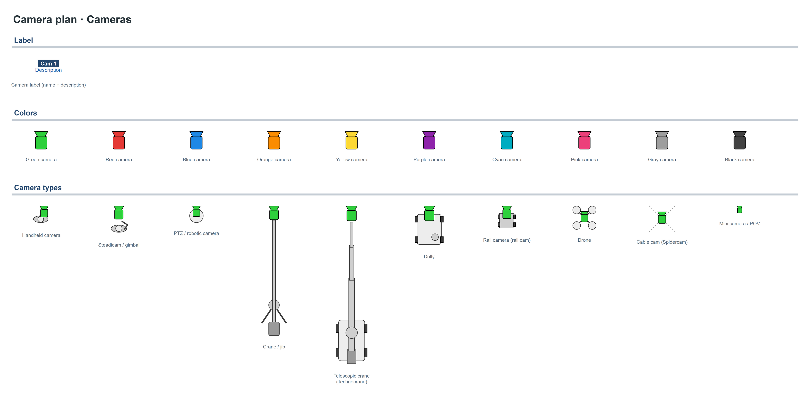
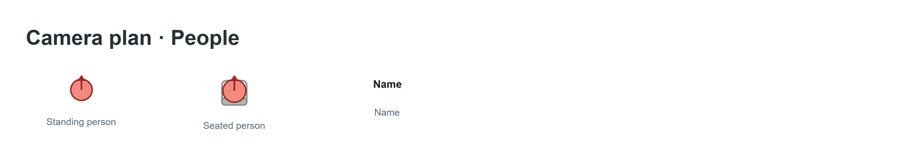
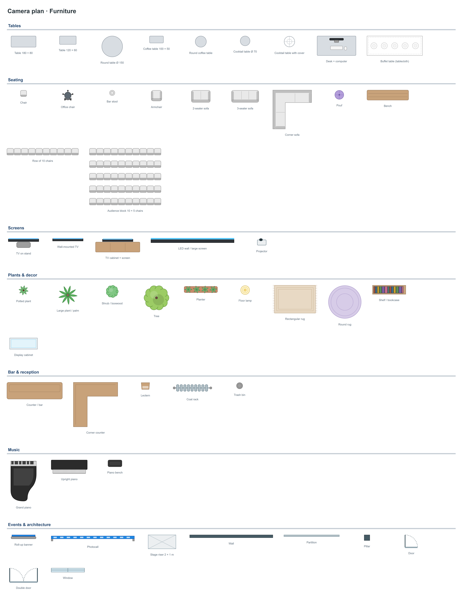

# Camera plan — draw.io shape libraries

Shape libraries for drawing **top-down camera plans** in draw.io (diagrams.net): lay out cameras, camera rigs, people and set elements for a film shoot, a live broadcast, a TV studio or an event.

**[▶ Open draw.io with all 3 libraries loaded](https://app.diagrams.net/?splash=0&clibs=Uhttps%3A%2F%2Fraw.githubusercontent.com%2FJejeSwag%2Fplan-camera-drawio%2Fmain%2Flibs%2Fcamera-plan-cameras.xml;Uhttps%3A%2F%2Fraw.githubusercontent.com%2FJejeSwag%2Fplan-camera-drawio%2Fmain%2Flibs%2Fcamera-plan-people.xml;Uhttps%3A%2F%2Fraw.githubusercontent.com%2FJejeSwag%2Fplan-camera-drawio%2Fmain%2Flibs%2Fcamera-plan-furniture.xml)**

## Previews

### Cameras



### People



### Furniture



## Contents

| Library | File | Shapes |
| --- | --- | --- |
| Cameras | [`libs/camera-plan-cameras.xml`](libs/camera-plan-cameras.xml) | 21 |
| People | [`libs/camera-plan-people.xml`](libs/camera-plan-people.xml) | 3 |
| Furniture | [`libs/camera-plan-furniture.xml`](libs/camera-plan-furniture.xml) | 52 |

The file [`catalog/camera-plan-catalog.drawio`](catalog/camera-plan-catalog.drawio) shows every shape, one page per library.

### Cameras

- **"Cam / Description" label**, listed first, to name each camera and describe its role.
- **10 camera colors**: green, red, blue, orange, yellow, purple, cyan, pink, gray, black.
- **10 camera types**: handheld camera, Steadicam / gimbal, PTZ / robotic camera, crane / jib, telescopic crane (Technocrane), dolly, rail camera (rail cam), drone, cable cam (Spidercam), mini camera / POV.

### People

Standing person, seated person, "Name" text.

### Furniture

- **Tables**: rectangular and round tables, coffee tables, cocktail tables, desk + computer, buffet table.
- **Seating**: chair, office chair, bar stool, armchair, sofas (2-seater, 3-seater, corner), pouf, bench, row of 10 chairs, 10 × 5 audience block.
- **Screens**: TV on stand, wall-mounted TV, TV cabinet + screen, LED wall / large screen, projector.
- **Plants & decor**: potted plants, palm, shrub, tree, planter, floor lamp, rugs, shelf, display cabinet.
- **Bar & reception**: counter / bar, corner counter, lectern, coat rack, trash bin.
- **Music**: grand piano, upright piano, piano bench.
- **Events & architecture**: roll-up banner, photocall, 2 × 1 m stage riser, wall, partition, pillar, door, double door, window.

## Installation

### a) One-click link

Open this link: draw.io starts with the 3 libraries already loaded in the left panel.

> If the shapes panel is not visible, show it with **Ctrl+Shift+K** (or the button at the top left of the toolbar → **Shapes**).

```
https://app.diagrams.net/?splash=0&clibs=Uhttps%3A%2F%2Fraw.githubusercontent.com%2FJejeSwag%2Fplan-camera-drawio%2Fmain%2Flibs%2Fcamera-plan-cameras.xml;Uhttps%3A%2F%2Fraw.githubusercontent.com%2FJejeSwag%2Fplan-camera-drawio%2Fmain%2Flibs%2Fcamera-plan-people.xml;Uhttps%3A%2F%2Fraw.githubusercontent.com%2FJejeSwag%2Fplan-camera-drawio%2Fmain%2Flibs%2Fcamera-plan-furniture.xml
```

### b) From draw.io, by URL

In draw.io: **File → Open Library from → URL…**, then paste one of these URLs (one per library):

```
https://raw.githubusercontent.com/JejeSwag/plan-camera-drawio/main/libs/camera-plan-cameras.xml
https://raw.githubusercontent.com/JejeSwag/plan-camera-drawio/main/libs/camera-plan-people.xml
https://raw.githubusercontent.com/JejeSwag/plan-camera-drawio/main/libs/camera-plan-furniture.xml
```

### c) Offline (draw.io desktop)

1. Download the `.xml` files from the [`libs/`](libs/) folder (or the whole repository: **Code → Download ZIP**).
2. In draw.io: **File → Open Library…**, then select the files.

## Tips

- **Scale**: 1 m = 50 px. Set the grid accordingly to keep realistic proportions.
- **One block per item**: every shape is a single ungrouped block. One click moves it, and the rotation handle turns it.
- **Upright text**: text (camera labels, names) does not rotate with the shape, so it always stays readable.
- **Color**: change it with the **fill** setting (Style panel).
- **Orientation**: by default, the front of each item faces **up**.

## License and credits

These libraries are released under the [Creative Commons Attribution 4.0 International (CC BY 4.0)](https://creativecommons.org/licenses/by/4.0/) license — see [`LICENSE`](LICENSE). You may use, adapt and share them, including commercially, as long as you credit the source:

> "Camera plan — draw.io shape libraries", [github.com/JejeSwag/plan-camera-drawio](https://github.com/JejeSwag/plan-camera-drawio), CC BY 4.0.

Shapes made for [draw.io / diagrams.net](https://www.diagrams.net/). draw.io is a trademark of its owner; this project is not affiliated with it.
